# StatusRobot architecture

Start with the overview, then follow one feature from its React page to its service and database. The diagrams describe the code in this repository, not a planned system.

## 1. Overview

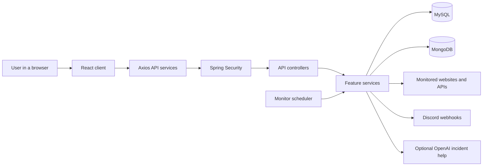

The client displays data and handles forms. Database access, monitor checks, webhook delivery and OpenAI calls run in the backend. The browser never receives database credentials, the OpenAI key or saved webhook URLs.

## 2. Where the code lives

| Folder or file | Responsibility |
| --- | --- |
| `client/src/main.tsx` | Starts React. |
| `client/src/App.tsx` | Reads the hash route and checks the signed-in session. |
| `client/src/pages/` | Landing, login, account and dashboard screens. |
| `client/src/components/` | Reused forms, charts, workspace picker and pagination. |
| `client/src/services/api.ts` | Shared Axios settings and public monitoring requests. |
| `client/src/services/requests.ts` | Shared dashboard requests, CSRF headers and error handling. |
| `client/src/services/` | Named API methods for authentication and each feature. |
| `server/.../BackendApplication.java` | Starts Spring Boot and enables scheduling. |
| `server/.../config/` | Security, OAuth, HTTP clients and database configuration. |
| `server/.../auth/` | Accounts, password hashing, OAuth users and login limits. |
| `server/.../monitor/` | Monitor configuration and CRUD. |
| `server/.../ping/` | HTTP checks, recorded results, statistics and history. |
| `server/.../incident/` | Outages, updates, publication and optional incident help. |
| `server/.../maintenance/` | Planned windows and their selected monitors. |
| `server/.../team/` | Invitations, roles and shared-workspace access. |
| `server/.../statuspage/` | Public pages, selected monitors and the pinned homepage. |
| `server/.../integration/` | Encrypted Discord channels and outage alerts. |
| `server/.../ApiErrors.java` | Common responses for `ResponseStatusException`. |

`server/.../` means `server/src/main/java/com/djmahirnationtv/status/backend/`.

## 3. A request from a React form to MySQL

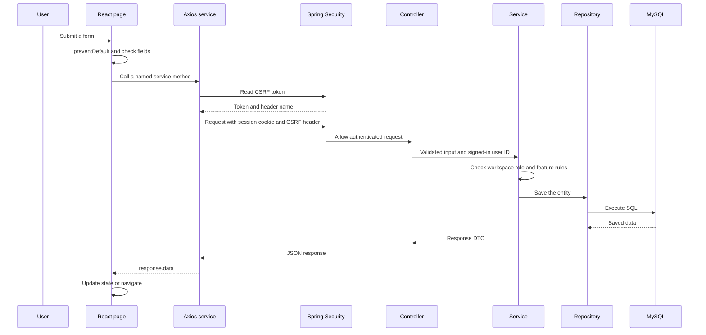

GET requests do not need a CSRF header. Writes do. A controller handles the HTTP entry point. A service contains the feature rules. A repository is the database access layer, not the database itself. Spring Data implements many repository operations for us.

The client sends form values, not a trusted user identity. The controller gets the signed-in user ID from `Authentication`. A workspace ID in a URL selects a workspace, but does not give access to it.

## 4. How React updates the screen

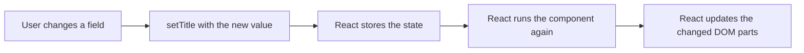

- `useState` stores values such as the title, selected monitors, loading flag or error. Its setter schedules an update. It does not limit network requests.
- `useEffect` runs work after rendering, such as loading data when a page opens or its workspace changes. Its dependency list controls when it runs again.
- Effect cleanup stops timers and marks an old request result as inactive. It does not give the database extra time to save. Our `active` flag ignores late results, but does not cancel the HTTP request itself.
- `props` are inputs passed from a parent component. For example, `DashboardPage` passes `workspaceId` to the list and editor pages.
- `FormEvent<HTMLFormElement>` is a TypeScript type for a form event. It is not another React feature. `event.preventDefault()` stops the browser's normal form submission and page reload.
- `useRef` stores a reference without causing a render. Maintenance uses it to focus the confirmation panel.
- `useSyncExternalStore` in `App.tsx` subscribes to hash changes. Routes such as `#dashboard/incidents/` stay inside the browser, so the server does not need a separate route for each screen.

`WorkspacePicker` and `Pagination` use ordinary props. They reuse the same controls and CSS. The pages still use normal `useState`, `useEffect` and functions, without a separate state-management package.

## 5. Accounts and security

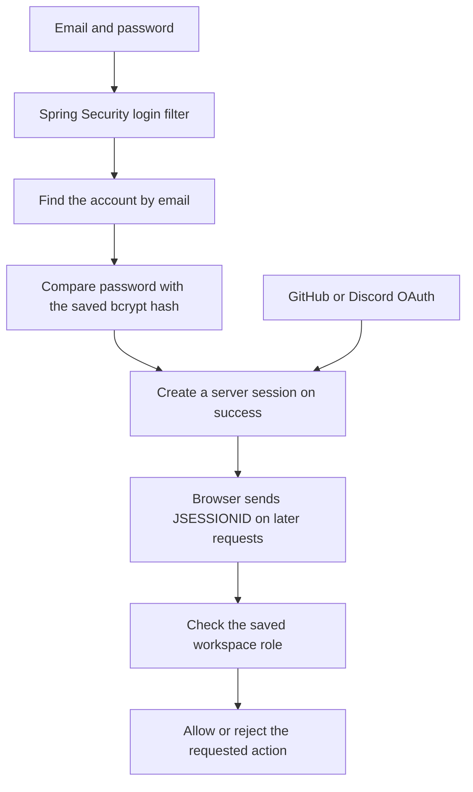

Passwords are hashed, not encrypted. Bcrypt stores a salt with the hash. Login uses the password encoder's comparison, not a new random hash followed by a simple string comparison. There is no password-decryption function.

`SecurityConfig` configures sessions, CSRF, allowed frontend origin, login, logout and OAuth. The login filter handles `/api/auth/login`, rather than an ordinary controller method. Logout invalidates the session. `AuthRateLimitFilter` limits login and registration attempts per remote address.

CSRF protection requires a token on write requests because a browser can send session cookies automatically. CORS controls which frontend origin may read credentialed API responses. They are different checks. Secure cookies and HTTPS still need correct deployment settings.

The current public GET endpoints include monitor details, pings, statistics and history. They are not made private by the dashboard login. Public status-page DTOs expose only their selected monitors and published notices. Review public endpoint exposure before deploying private service information.

## 6. Workspaces and team roles

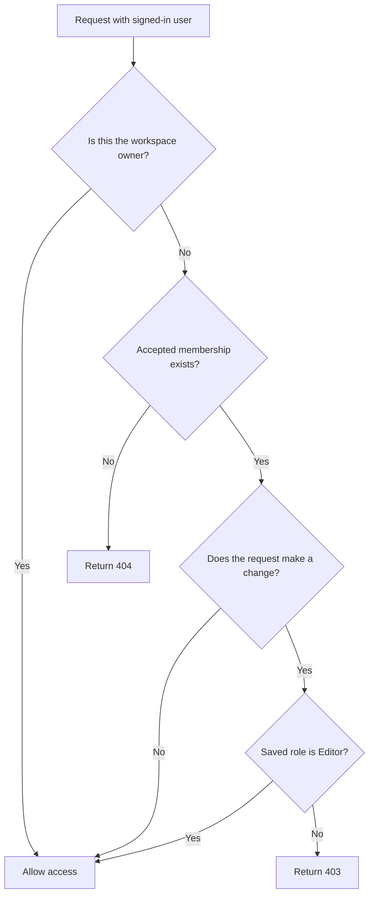

`TeamService.requireAccess(ownerId, userId, editing)` performs these checks. `ownerId` identifies the workspace owner. `userId` identifies the signed-in person. They are different when a teammate acts. `editing` means that Editor access is required.

| Role | Monitors | Incidents | Maintenance | Workspace administration |
| --- | --- | --- | --- | --- |
| Owner | Read and manage | Read, create, update, publish and request analysis | Read, schedule, edit, publish, cancel and delete | Manages team, status pages and integrations |
| Editor | Read and manage | Read, create, update, publish and request analysis | Read, schedule, edit, publish, cancel and delete | Cannot manage the owner's team, status pages or integrations |
| Viewer | Read | Read, including private notes | Read, including private descriptions | Cannot make changes |
| Pending invitation | No shared access | No shared access | No shared access | Must accept first |

Each account also owns its personal workspace. A Viewer in someone else's workspace can still manage their own workspace. Accepted roles are checked again on every backend request. Removal and downgrading affect the next request. Hiding buttons in React is only a convenience, not the permission check.

New incidents belong to the selected monitor's owner. New maintenance uses the selected workspace, and every selected monitor must belong to it. Editing an existing record uses its saved owner, so changing the URL cannot move it. Private DTOs include `workspaceId` so the client can show the right controls. Public incident and maintenance DTOs do not include it.

## 7. MySQL and MongoDB

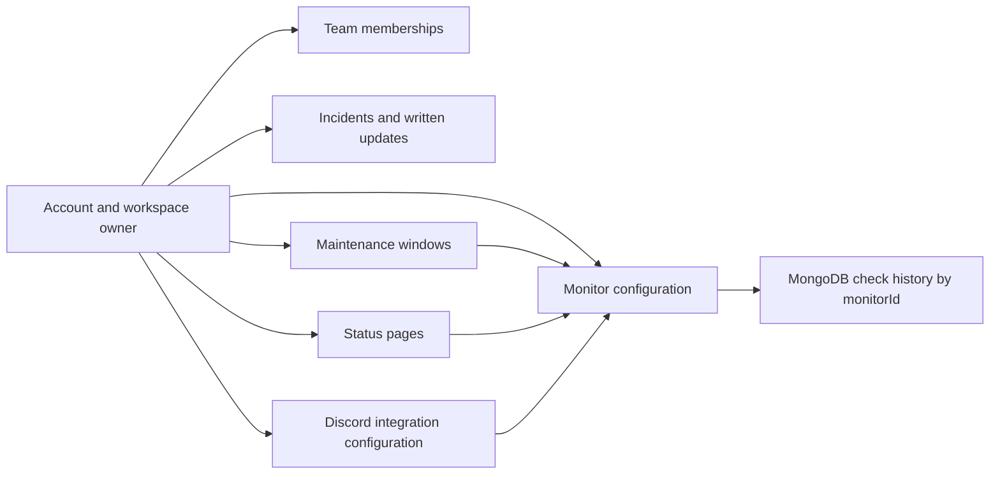

This shows logical ownership and links. It does not mean every arrow is a SQL foreign key. MongoDB has no foreign key to MySQL.

| Store | Tables or collection | Data |
| --- | --- | --- |
| MySQL | `app_users` | Accounts, password hashes and OAuth provider identity |
| MySQL | `monitors` | Name, URL, method, interval, timeout, owner and latest status |
| MySQL | `team_members` | Owner, invited account, accepted flag and role |
| MySQL | `incidents`, `incident_updates` | Outages, progress, written messages and publication |
| MySQL | `maintenance_windows`, `maintenance_monitors` | Dates, cancellation, publication and selected monitors |
| MySQL | `status_pages`, `status_page_monitors` | Page address, homepage pin and selected monitors |
| MySQL | `discord_integrations`, `monitor_integrations` | Encrypted webhook configuration and selected channels |
| MongoDB | `ping_logs` | Timestamp, monitor ID, status code, response time, success and error |

`@Entity` maps a Java object to MySQL. `@Document` maps a check log to MongoDB. Hibernate currently updates SQL tables on application startup. Back up the database before changing the schema. The team-access change uses existing tables and adds no migration.

## 8. Automatic monitoring and Discord alerts

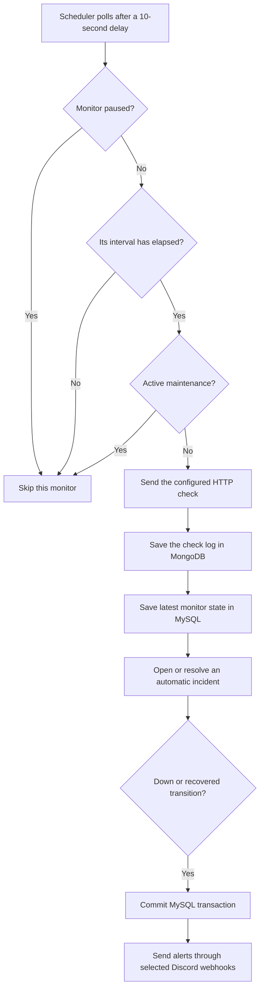

The 10-second delay is the scheduler's polling delay after its previous run finishes. It is not every monitor's interval. `isDueForPing()` compares `lastCheckedAt` with that monitor's configured interval. The HTTP checks run sequentially in the current scheduler.

`PingExecutionService` performs the HTTP request. Codes from 200 to 399 are successful. Failed requests produce `DOWN`. A successful response taking more than 1500 ms produces `DEGRADED`. Other successful responses produce `UP`.

A failed check opens one automatic incident. Repeated failures use the same incident. A later successful check closes it, including a slow successful check. A unique `openMonitorId` prevents duplicate open automatic incidents for the same monitor.

`DiscordAlertListener` runs after the MySQL transaction commits. It sends outage and recovery transitions, not a message for every check. `WebhookSecrets` encrypts saved webhook URLs with AES-GCM. Unlike password hashes, webhook URLs need decryption so the backend can send requests to them. Losing the encryption key makes saved webhooks unreadable.

## 9. Incidents, maintenance and public pages

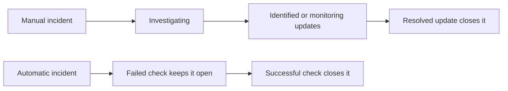

Manual incidents are separate from automatic checks. They start private with a first written update. Only a resolved update closes them. Editors cannot use a written update to close an automatic incident before a successful check.

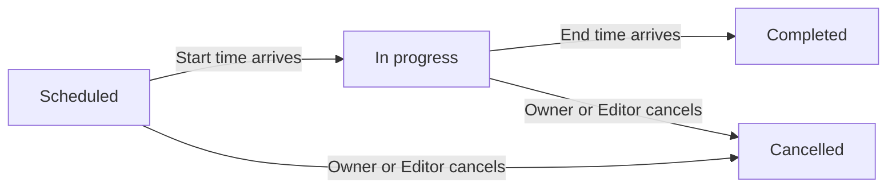

`Maintenance.statusAt(now)` calculates status from its dates and cancellation flag. There is no separate status-update job. Start is included in the active window, end is excluded. Only upcoming windows can be edited. Active windows must be cancelled before deletion. Overlapping windows keep checks skipped while any window remains active.

Maintenance does not pause a monitor permanently, close an existing incident or invent healthy check results. Checks already running are not interrupted. After the last active window ends, normal due checks resume. A manually paused monitor stays paused.

`StatusPageService` chooses the monitors for each public page and adds matching published incidents and maintenance. Unpublished records are visible to accepted workspace members, but not public visitors. An Owner or Editor can publish them. Public pages refresh every 30 seconds. Active published maintenance adds the "Under maintenance" label, while manually paused monitors still show "Paused".

`HomePage` checks `/api/status-pages/default`. A pinned page replaces the landing page. A 204 response means there is no pinned page. Only the server owner can pin a page, and only one page can be pinned at a time.

`PingHistoryService` groups MongoDB logs into periods, daily uptime and response-time buckets. The charts offer 6 hours, 24 hours and 7 days. Daily bars show 90 UTC days. Uptime is successful recorded checks divided by recorded checks. Missing checks have no data, rather than counting as successful. Pauses and skipped maintenance checks do not improve uptime.

## 10. Optional incident help

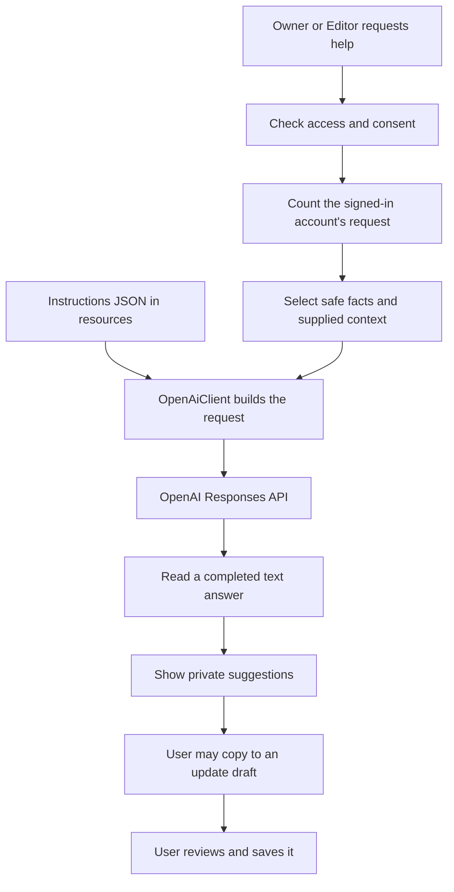

`IncidentAnalysisService` checks consent and configuration, starts a counted request, calls `OpenAiClient` and returns the result. Its `finally` block calls `finishRequest()` even when the API fails. It does not automatically save or publish suggestions.

`OpenAiClient` loads `server/src/main/resources/openai/incident-analysis.json`. Instructions are loaded at startup, so changes require a rebuild and restart. The request sends safe check results, progress, timestamps and the context entered for this request. It does not send monitor names, URLs, workspace IDs or saved update text.

The app calls `/v1/responses` with `store: false` and no tools. This disables response storage for later API retrieval, not every possible data-retention policy. See the [official OpenAI documentation](https://developers.openai.com/api/docs/guides/migrate-to-responses). Model and key are backend configuration, not frontend values.

The current limits are 5 requests per signed-in account and 100 requests per backend instance per hour, with at most 3 running. Failed attempts count. A teammate's request counts against that teammate, not the workspace owner. Viewers cannot request analysis. Limits are held in memory and reset after a restart. Multiple server instances do not share these counters.

## 11. Java terms used here

| Term | Plain meaning in this project |
| --- | --- |
| DTO | A data object that controls the fields accepted or returned by the API. It is not an API or a database query itself. |
| `record` | A short way to declare a data holder, used for many DTOs. |
| `@Valid`, `@NotBlank`, `@Size` | Ask Spring to check request values before running feature code. |
| `@Service`, `@Component` | Let Spring create and manage the object. |
| Constructor injection | Spring supplies the dependencies listed in a constructor. |
| `@Configuration`, `@Bean` | Declare shared objects and application settings. |
| `@Value` | Read a configured value, such as a key or frontend URL. |
| `@Getter`, `@Setter` | Lombok generates ordinary getter and setter methods while compiling. |
| `@Transactional` | Group the SQL changes in a method into one transaction. A rollback-causing failure undoes that transaction's SQL changes. Runtime exceptions normally cause rollback. |
| `@Transactional(readOnly = true)` | Describe a read operation to the transaction system. It is not a cache or a permission check, and is not a universal write-blocking guarantee. |
| `@Version` | Detect conflicting saves so an old entity cannot overwrite a newer change. It does not lock every HTTP request. |
| `ResponseStatusException` | Stop a request with an HTTP status and a readable reason. `ApiErrors` turns it into a JSON message. |
| `IllegalStateException` | Report that an operation cannot proceed in the current state, such as an unreadable instructions file. |
| `stream().map(...).toList()` | Transform a collection into another list, similar to JavaScript `array.map(...)`. It does not automatically run work in parallel. |
| `Optional` | A result that may contain a value or may be empty, such as a missing database record. |
| `synchronized` | Let only one thread run the protected counter method at a time on the same object. Other threads wait for that short method. |
| `Clock` | Supply the current time. Tests can supply a controlled clock. |
| `resetAt` | The time when hourly counters may reset on a later request. It does not reset the system clock or control monitor intervals. |

The MySQL transaction does not automatically undo an HTTP request, a Discord message or an already saved MongoDB log. This application does not use a distributed transaction across the two databases.

## 12. Build and deployment

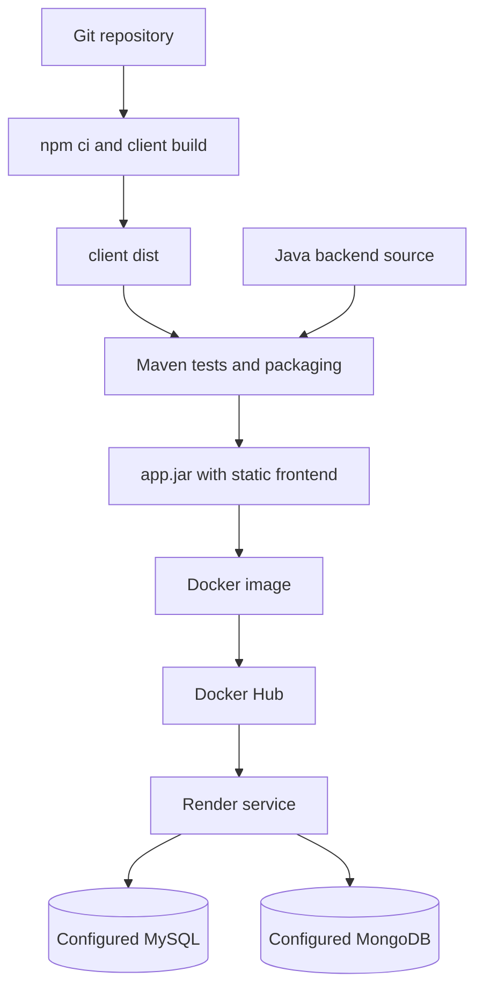

Vite builds the frontend. Maven includes `client/dist` as static resources in the JAR. The Dockerfile packages that compiled JAR rather than compiling the source. Spring Boot serves the frontend and API on one port. The Compose file currently starts MongoDB only, not the application or MySQL.

GitHub Actions run lint, client API tests and backend tests. Publishing and the Render deploy hook run for pushes to `main` or `production`, not feature-branch pushes. This guide does not contain deployment credentials. Setup and environment variables are in [README.md](README.md).

## 13. Practice questions with short answers

1. **Why does changing `setTitle` update the page?** React stores the new state and renders the component again. A normal variable assignment does not trigger that update.
2. **Does `useState` stop repeated API calls?** No. Our effects, event handlers and timer guards control requests.
3. **Why clear an interval when leaving a page?** Otherwise the old timer can keep sending requests after its page is gone.
4. **What does `FormEvent<HTMLFormElement>` do?** It describes the form event for TypeScript. It disappears when compiling to JavaScript.
5. **Why use `preventDefault()`?** To handle the form in React without a normal browser submission and reload.
6. **What is `http` in the client?** The configured Axios instance. `response.data` is the returned body.
7. **Why still validate in the backend?** Anyone can bypass the form and send an API request directly.
8. **What is the difference between controller, service and repository?** HTTP handling, feature rules and database access.
9. **Why use a DTO instead of returning an account entity?** To return only the intended fields, without exposing its password hash.
10. **Where does the signed-in user ID come from?** Spring Security's authenticated session, not a trusted ID in the request body.
11. **Can an Editor move a maintenance window by changing `workspaceId`?** No. Existing windows keep their saved owner, and selected monitors must belong to that workspace.
12. **Why are Owner and user IDs sometimes different?** A teammate acts using their own session on records belonging to another account's workspace.
13. **Can pending or removed members use a known record ID?** No. The backend checks accepted membership again.
14. **Does `@Transactional` mean caching?** No. It controls committing or rolling back database changes.
15. **Does `@Transactional` roll back MongoDB and HTTP too?** Not with this application's SQL transaction. Those operations are separate.
16. **What closes automatic and manual incidents?** A successful check closes an automatic incident. A resolved update closes a manual incident.
17. **Does maintenance improve uptime with fake successful checks?** No. Skipped checks create no samples.
18. **Why are password hashes different for the same password?** Bcrypt uses a salt. Login compares the supplied password using the saved hash and salt.
19. **What does `synchronized` protect here?** Changes to analysis counters. It does not keep the whole HTTP analysis call inside the lock.
20. **What does `finally` do in incident help?** It releases the running-request count whether the request succeeds or fails.
21. **What happens when an Editor publishes an incident?** Its written updates appear on matching status pages owned by that workspace's owner.
22. **How does the homepage become a status page?** `HomePage` reads the one pinned default page, otherwise it shows the landing page.

To prepare for a presentation, trace one normal request, one rejected request and one scheduled monitor check. Then explain the workspace-role diagram and why the databases store different data.
