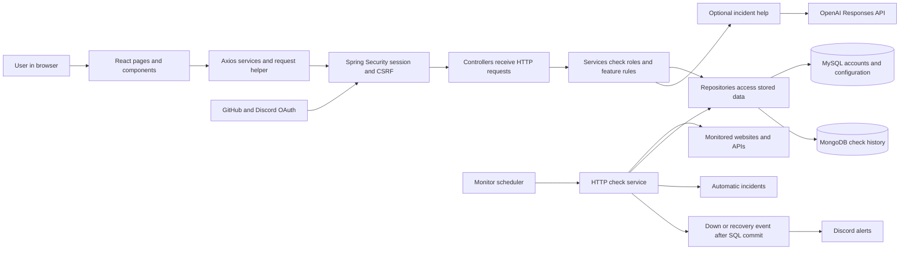
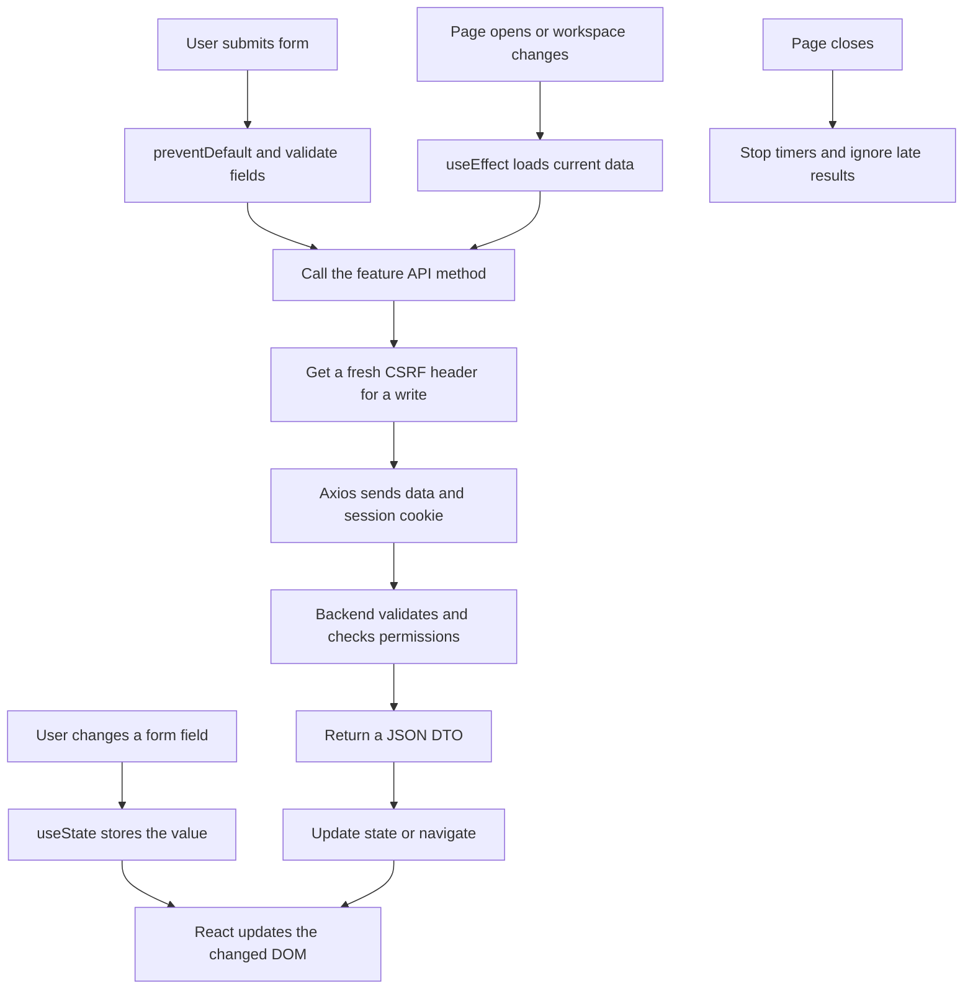
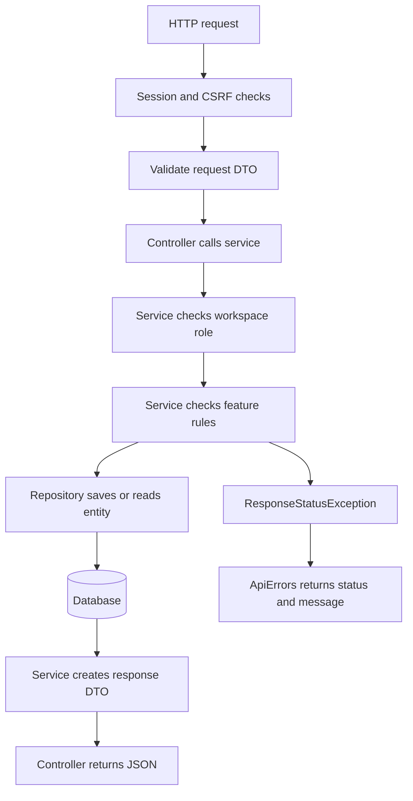
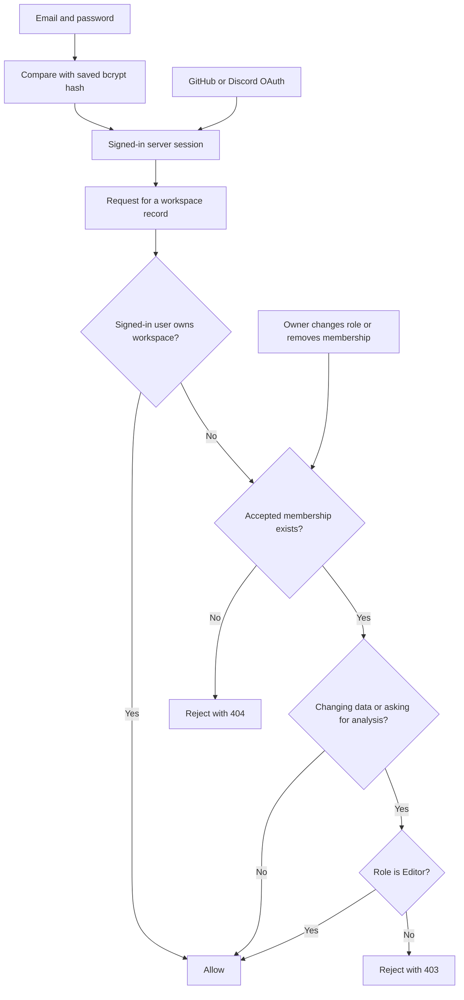
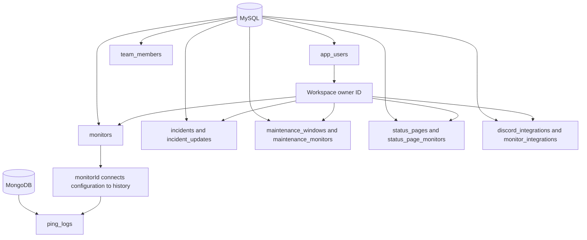
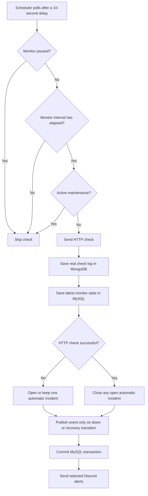
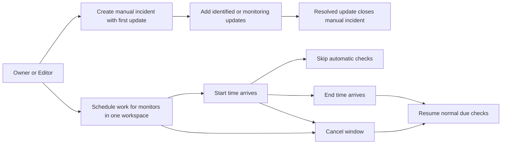
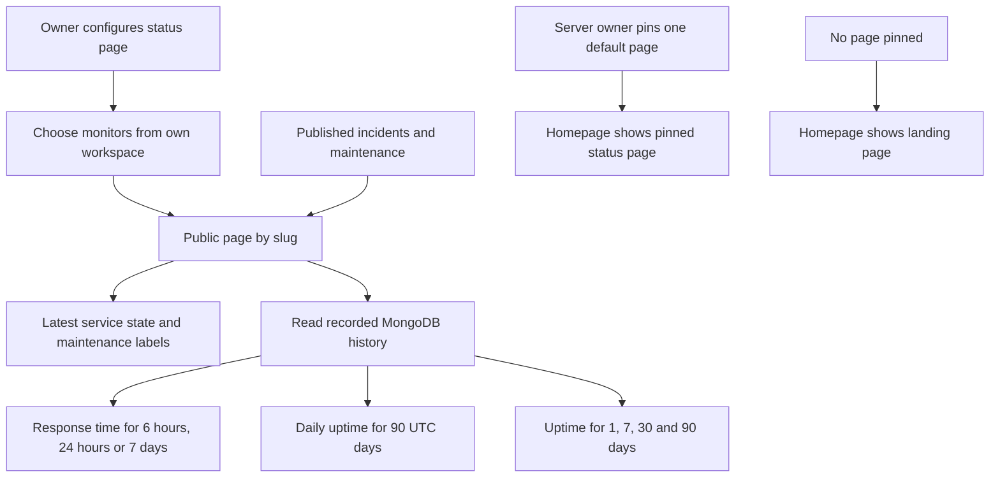
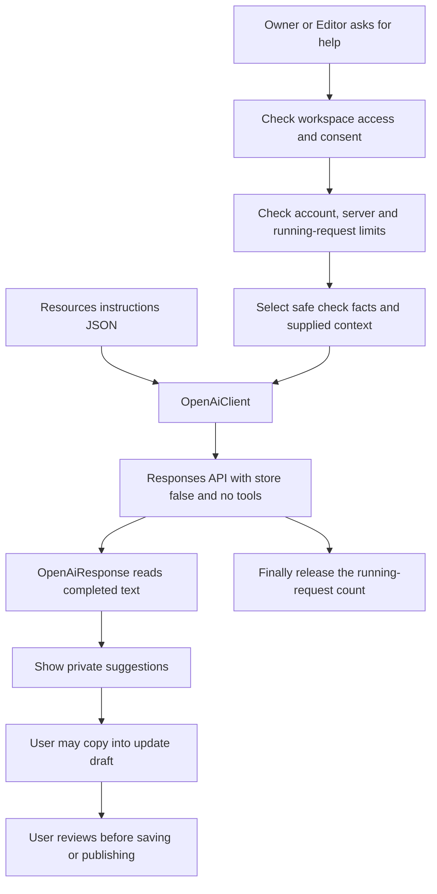
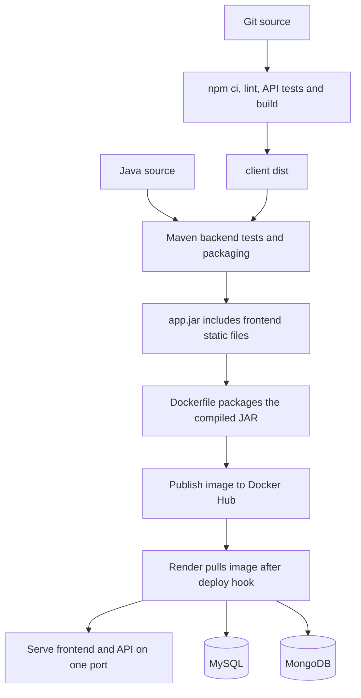

# StatusRobot diagrams for Excalidraw

This file uses the requested name `exceldraw.md`. The drawing tool is called Excalidraw.

Open its Mermaid import, often labelled **Mermaid to Excalidraw** or found under **Text to diagram**. Copy the contents of one code block, starting with `flowchart`, without the Markdown fence lines. Import the diagrams separately so labels remain readable. The diagrams use basic flowchart shapes and avoid styling that depends on a particular converter version.

Excalidraw provides a [Mermaid converter](https://docs.excalidraw.com/docs/@excalidraw/mermaid-to-excalidraw/api). GitHub can also display these [Mermaid blocks](https://docs.github.com/en/get-started/writing-on-github/working-with-advanced-formatting/creating-diagrams). See [architecture.md](architecture.md) for the explanations and practice questions.

## 1. Whole application

## 2. React and API requests

## 3. Backend layers

## 4. Accounts and team permissions

Only the owner manages the owner's team, status-page configuration and integrations. Editors can publish incidents and maintenance on existing matching status pages. Viewers can read shared operational records, including private notes, but cannot write.

## 5. Database responsibilities

These are logical relationships. Not every line is a SQL foreign key. The SQL transaction does not include MongoDB logs or outgoing HTTP requests.

## 6. Monitoring and incidents

## 7. Manual incidents and maintenance

An automatic incident still needs a successful check to close. Maintenance does not close incidents or unpause manually paused monitors. Overlapping active windows keep checks skipped.

## 8. Public status pages and charts

Only published notices appear publicly. Skipped and missing checks do not become successful samples. The public page refreshes every 30 seconds.

## 9. Optional OpenAI help

Scheduled checks do not call OpenAI. The key stays in backend settings. Limits count the account making the request. A failed request counts too, and no automatic retry is made. Instructions changes require a rebuild and restart.

## 10. Build and deployment

Publishing runs on pushes to `main` or `production`, not feature branches. Docker Compose currently starts MongoDB only. See [README.md](README.md) for setup.
